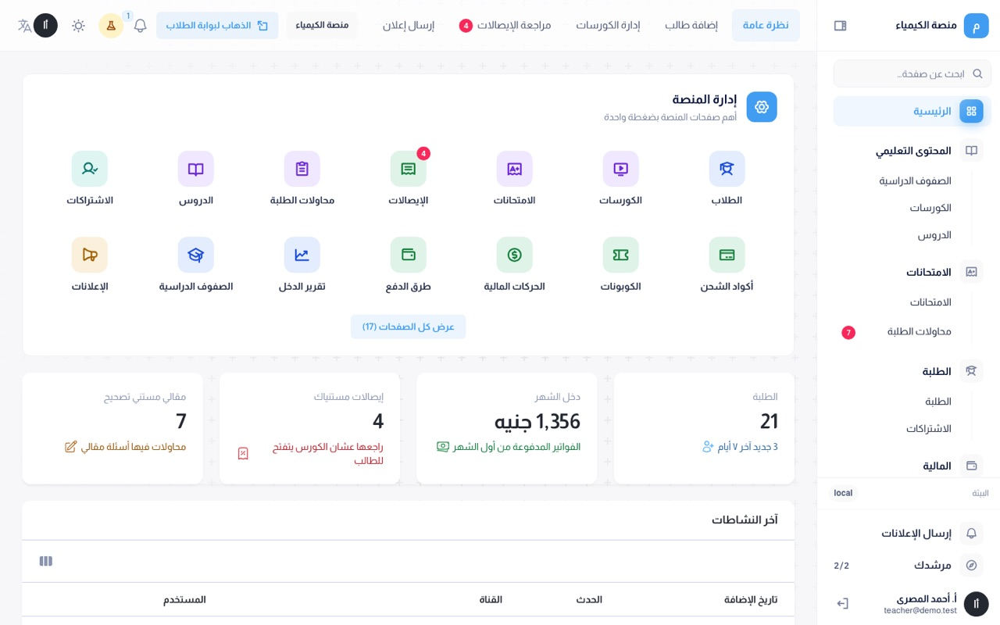
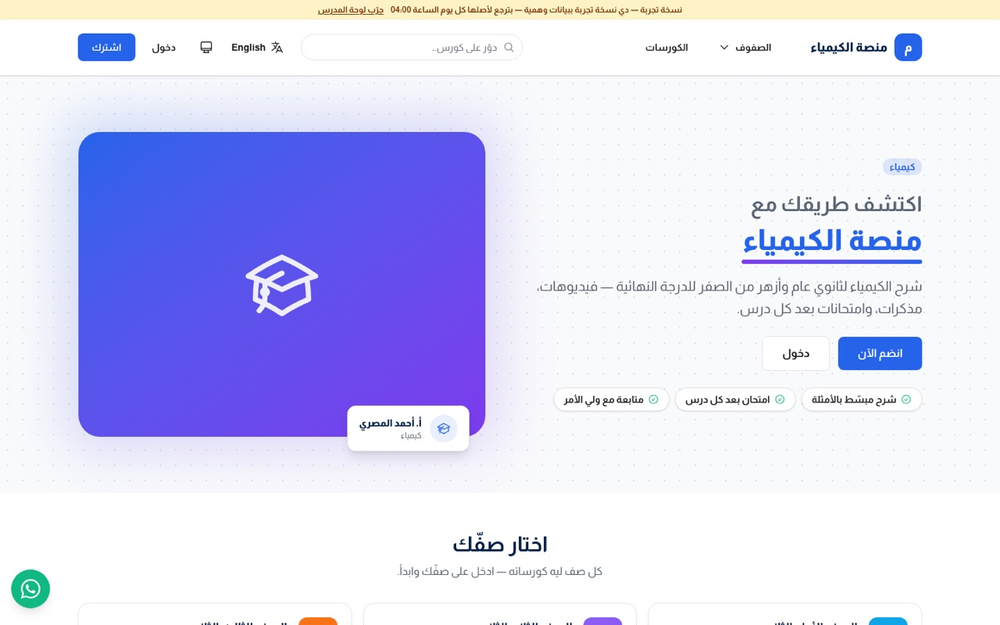
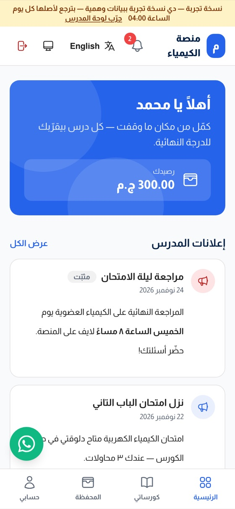
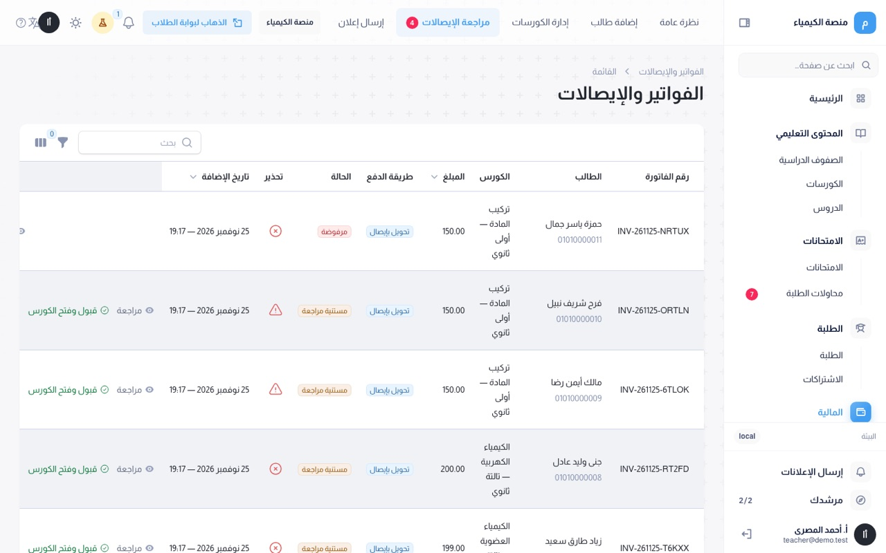
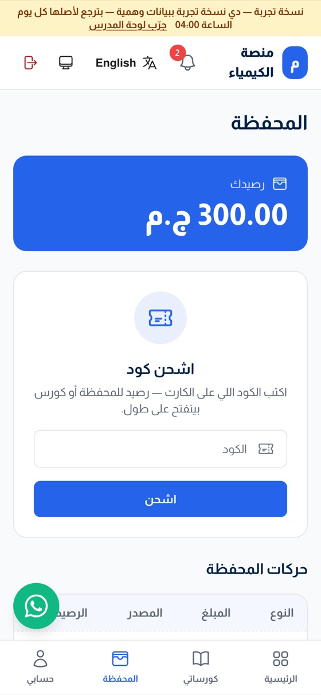
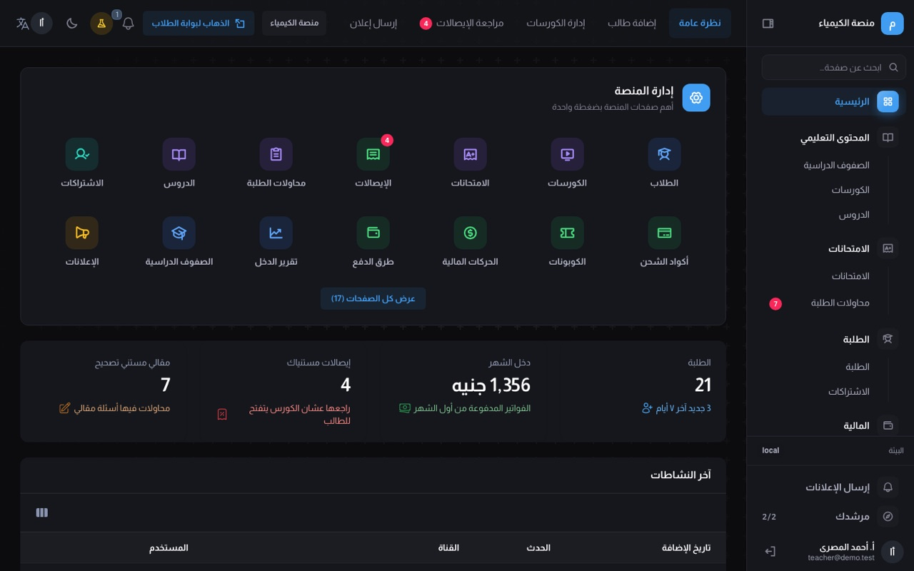
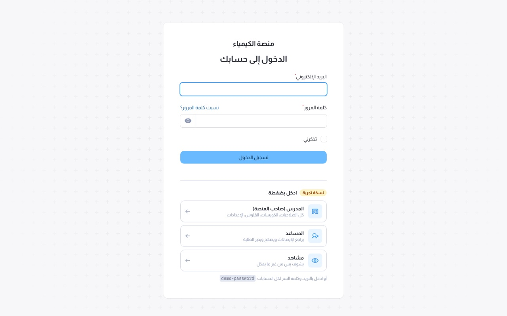

<div align="center">

# طفرة — منصة تعليمية مجانية للمدرّس

**منصتك أنت، على استضافتك أنت.** كورسات وامتحانات وطلبة وتحصيل فلوس بفودافون كاش وإنستاباي.
مجانية ومفتوحة المصدر، وبتتثبّت على أي استضافة عادية في دقايق، من غير ما تعرف برمجة.

[](https://github.com/Tafrah/tafra-open-lms/actions/workflows/ci.yml)
[](LICENSE)


[التثبيت](#التثبيت) · [جرّبها الأول](#جرّبها-قبل-ما-تثبّتها) · [المميزات](#المنصة-بتعمل-إيه) · [دليل المدرّس](docs/teacher-guide.md) · [English](#english)



</div>

---

## ليه طفرة المفتوحة؟

- **ببلاش بجد:** مفيش اشتراك شهري ولا نسبة من فلوسك. بتدفع بس تمن الاستضافة، وأي استضافة مشتركة عادية فيها PHP وMySQL تنفع.
- **بياناتك ملكك:** الطلبة والفلوس والمحتوى على سيرفرك، وتقدر تاخد نسخة كاملة في ملف واحد في أي وقت.
- **معمولة لمدرّس مصري:**
  - التحويل بفودافون كاش وإنستاباي برفع صورة الإيصال.
  - أكواد شحن مطبوعة للسنتر.
  - رقم ولي الأمر.
  - حد للأجهزة عشان الحساب مايتشيرش.
  - كل حاجة بالعربي وبالمصري.
- **من غير خبرة تقنية:** ترفع ملف، تفتح صفحة التثبيت، تكتب اسم منصتك، وخلاص. التحديثات بضغطة من جوه اللوحة.

## المنصة بتعمل إيه؟

| | |
|---|---|
| 🎬 **المحتوى** | <ul><li>كورسات بأجزاء.</li><li>دروس فيديو يوتيوب أو PDF (تقفل التنزيل أو تسمح بيه) أو نص.</li><li>عدد مشاهدات لكل درس، ومواعيد ظهور، ومعاينة مجانية قبل الشراء.</li></ul> |
| 📝 **الامتحانات** | <ul><li>اختيار من متعدد ومقالي، بصور، والطالب يقدر يصوّر إجابته.</li><li>مدة وعدد محاولات ودرجة نجاح.</li><li>تقفل الدرس اللي بعده لحد ما الطالب ينجح.</li><li>استيراد الأسئلة من Excel، وتصحيح المقالي من اللوحة.</li></ul> |
| 👨‍🎓 **الطلبة** | <ul><li>تسجيل بالموبايل، والطالب بيشوف كورسات سنته الأول.</li><li>تفعيل طلبة السنتر بلصق أرقامهم.</li><li>فصل الأجهزة، ومشاهدات زيادة، وإعادة محاولات.</li><li>تصدير Excel.</li></ul> |
| 💰 **الفلوس** | <ul><li>إيصالات التحويل بقبول أو رفض بضغطة، مع **تحذير الإيصال المكرر**.</li><li>محفظة للطالب، وأكواد شحن تتطبع، وكوبونات خصم.</li><li>حد شهري لكل رقم تحويل.</li><li>تقرير دخل شهر بشهر.</li></ul> |
| 🔔 **التواصل** | <ul><li>إعلانات بتظهر للطلبة.</li><li>إشعارات بقبول الإيصال وبتصحيح الامتحان.</li><li>زرار واتساب عائم.</li></ul> |
| 👥 **فريقك** | <ul><li>مساعدين بصلاحيات: مساعد يراجع ويصحّح، ومشاهد يشوف بس.</li><li>كل عملية بتتسجّل باسم اللي عملها.</li></ul> |
| 🌐 **موقعك** | <ul><li>صفحة رئيسية باسمك ولوجوك وألوانك.</li><li>كتالوج كورسات، ومنطقة للطالب.</li><li>عربي وإنجليزي، ووضع داكن، وبيشتغل كويس على الموبايل.</li></ul> |
| 🛟 **الأمان والنسخ** | <ul><li>تحقق بخطوتين للوحة.</li><li>نسخ احتياطي يومي، وتصدير كامل في ملف واحد.</li><li>نقل للنسخة المدفوعة من طفرة بنفس كلمات سر الطلبة.</li></ul> |

<table>
  <tr>
    <td width="62%"></td>
    <td></td>
  </tr>
  <tr>
    <td></td>
    <td></td>
  </tr>
</table>

<details>
<summary>الوضع الداكن</summary>


</details>

## التثبيت

اختار الطريقة اللي تناسبك. التلاتة بيوصلوك لنفس المنصة.

| الطريقة | مناسبة لمين | الخطوات |
|---|---|---|
| **استضافة مشتركة**<br>(cPanel / Hostinger) | أي مدرّس، من غير SSH ولا خبرة | <ol><li>نزّل الـ zip من [آخر إصدار](https://github.com/Tafrah/tafra-open-lms/releases/latest).</li><li>ارفعه وفكّه.</li><li>اعمل قاعدة MySQL.</li><li>افتح `/install`.</li></ol>[الدليل خطوة بخطوة](docs/install/shared-hosting.md) |
| **VPS بأمر واحد** | سيرفر Ubuntu/Debian | `curl -fsSL https://raw.githubusercontent.com/Tafrah/tafra-open-lms/main/install.sh \| sudo bash`<br>بيجهّز Docker وMySQL وHTTPS لوحده. [التفاصيل](docs/install/vps.md) |
| **Coolify** | لو عندك Coolify | Docker Compose ← `docker-compose.coolify.yml`. الدومين وكلمات السر بتتولّد لوحدها. [التفاصيل](docs/install/coolify.md) |

**المطلوب:**
- **الاستضافة المشتركة:** PHP 8.4 وMySQL 8 (أو MariaDB 10.6+)، وسطر Cron واحد صفحة التثبيت بتديهولك.
- **مش مطلوب:** Redis، ولا عامل طابور، ولا Node، ولا SSH.

**بعد التثبيت:** لوحة التحكم على `yourdomain.com/admin`، وموقع الطلبة على الدومين نفسه. ابدأ بـ [دليل المدرّس](docs/teacher-guide.md): من أول كورس لحد مراجعة الإيصالات.

**التحديث:** لما يطلع إصدار جديد بيظهرلك شريط في اللوحة. على VPS شغّل أمر التثبيت تاني، والمنصة بتكمّل الباقي لوحدها.

## جرّبها قبل ما تثبّتها



نسخة تجربة فيها أكاديمية كيمياء كاملة:
- كورسات وامتحانات.
- ٢٠ طالب.
- إيصالات مستنية مراجعتك، منها واحد مكرر.
- امتحانات مقالية مستنية التصحيح.

صفحة الدخول فيها زراير: **ادخل كمدرس، أو كمساعد، أو كطالب** بضغطة.

```bash
DEMO_MODE=true php artisan lms:demo
```

على Docker/Coolify: حط `DEMO_MODE=true` في المتغيّرات وبس. وممكن تخليها ترجع لأصلها كل يوم.
[دليل نسخة التجربة](docs/install/demo.md)

<br clear="left">

## أسئلة بتتكرر

<details>
<summary><b>هي مجانية فعلاً؟ فين الفخ؟</b></summary>

مجانية ومفتوحة المصدر تحت رخصة AGPL-3.0، ومفيش أي حد في عدد الطلبة أو الكورسات. لو احتجت حاجات أكبر، زي تطبيق موبايل أو حماية فيديو أو أكتر من مدرّس، فيه [طفرة](https://tafra-tech.com) المدفوعة. نقلك ليها بيبقى بملف واحد.
</details>

<details>
<summary><b>أقدر أنقل بياناتي بعدين؟</b></summary>

أيوه. **نقل البيانات ← تصدير** بيطلّع ملف فيه كل حاجة: الطلبة والكورسات والامتحانات والمحافظ والصور. الملف ده بيتستورد في أي نسخة تانية أو في طفرة، والطلبة بيدخلوا بنفس كلمات السر. صيغة الملف موثّقة في [`docs/transfer/format.md`](docs/transfer/format.md).
</details>

<details>
<summary><b>الطالب ممكن يدّي حسابه لصاحبه؟</b></summary>

فيه حد للأجهزة لكل طالب. الافتراضي جهاز واحد، وإنت اللي بتحدده. لو حد حاول يدخل من جهاز زيادة بيترفض، وإنت تقدر تفصل الأجهزة من صفحة الطالب.
</details>

<details>
<summary><b>الفلوس بتوصلني إزاي؟</b></summary>

على أرقامك إنت مباشرة: فودافون كاش، أو إنستاباي، أو حسابك في البنك. الطالب بيحوّل ويرفع صورة الإيصال، وإنت بتقبل فيتفتحله الكورس فوراً. المنصة مابتلمسش فلوسك.
</details>

<details>
<summary><b>حصلت مشكلة — أعمل إيه؟</b></summary>

- **المشاكل المتكررة:** شوف آخر [دليل المدرّس](docs/teacher-guide.md#مشاكل-بتتكرر) و[جدول مشاكل الاستضافة](docs/install/shared-hosting.md).
- **لو لسه المشكلة موجودة:** افتح [Issue](https://github.com/Tafrah/tafra-open-lms/issues) واكتب نوع الاستضافة والخطوات اللي عملتها.
</details>

---

## للمطوّرين

**الستاك:** PHP 8.4 · Laravel 13 · Filament 5 · Livewire 4 · Tailwind 4 · MySQL 8.

**البنية:** DDD Contexts تحت `src/Contexts`، والتفويض كله في Policies، وكل نص مترجم عربي وإنجليزي. القواعد في [`CLAUDE.md`](CLAUDE.md)، وإزاي تساهم في [`CONTRIBUTING.md`](CONTRIBUTING.md).

```bash
composer setup            # تثبيت + migrate + seed + build
composer dev              # سيرفر + vite + طابور
composer test             # Pest (قاعدة MySQL: open_lms_testing)
composer test:browser     # رحلات المستخدم في متصفح حقيقي (Playwright)
DEMO_MODE=true php artisan lms:demo --fresh   # بيانات تجربة كاملة
```

| الـ Context | المسؤولية |
|---|---|
| `Academy` | الصفوف، والكورسات، والأجزاء، والدروس، والمشاهدات |
| `Exams` | الامتحانات، والأسئلة، والمحاولات، والتصحيح |
| `Students` | الطلبة والأجهزة |
| `Billing` | الفواتير، والإيصالات، والمحفظة، وأكواد الشحن، والكوبونات، والتقارير |
| `Storefront` | موقع الطلبة |
| `Transfer` | التصدير والاستيراد من وإلى طفرة |
| `Installer` | `/install`، و`lms:install`، والتحديث التلقائي |
| `Demo` | نسخة التجربة (`lms:demo`) والدخول بضغطة |
| `Identity` · `Tenancy` · `Settings` · `Content` · `Notifications` · `Media` · `Audit` · `Ai` | الأساس: الحسابات والصلاحيات، والإعدادات، والإعلانات، والإشعارات، والملفات، والسجل، وخادم MCP |

<details>
<summary>الوثائق التقنية</summary>

| الملف | المحتوى |
|---|---|
| [`docs/00-setup.md`](docs/00-setup.md) | بيئة التطوير المحلية |
| [`docs/01-architecture-ddd.md`](docs/01-architecture-ddd.md) | بنية DDD والـ Contexts والـ ServiceProviders |
| [`docs/02-permissions.md`](docs/02-permissions.md) | كتالوج الصلاحيات |
| [`docs/03-multi-tenancy.md`](docs/03-multi-tenancy.md) | تعدد المستأجرين والعزل |
| [`docs/04-media-filesystem.md`](docs/04-media-filesystem.md) | الملفات والـ DiskResolver |
| [`docs/05-settings.md`](docs/05-settings.md) | الإعدادات |
| [`docs/06-theme-branding.md`](docs/06-theme-branding.md) | الثيم وغلاف «طفرة البسيط» |
| [`docs/07-navigation-sidebar.md`](docs/07-navigation-sidebar.md) | السايدبار |
| [`docs/08-tables-ux.md`](docs/08-tables-ux.md) | الجداول والفلاتر والتصدير |
| [`docs/09-notifications.md`](docs/09-notifications.md) | الإشعارات |
| [`docs/10-i18n.md`](docs/10-i18n.md) | الترجمة وRTL |
| [`docs/11-logging-monitoring.md`](docs/11-logging-monitoring.md) | اللوجينج والمراقبة |
| [`docs/12-auth-security.md`](docs/12-auth-security.md) | التحقق بخطوتين والأجهزة وسجل النشاط |
| [`docs/13-queues-jobs.md`](docs/13-queues-jobs.md) | الطابور والجدولة على الاستضافة المشتركة |
| [`docs/14-production-https.md`](docs/14-production-https.md) | الإنتاج وHTTPS |
| [`docs/15-onboarding.md`](docs/15-onboarding.md) | الجولات الإرشادية |
| [`docs/16-adding-a-feature.md`](docs/16-adding-a-feature.md) | **الوصفة:** إزاي تضيف ميزة من الصفر |
| [`docs/17-testing-acceptance.md`](docs/17-testing-acceptance.md) | الاختبارات ومعايير القبول |
| [`docs/18-conventions.md`](docs/18-conventions.md) | اتفاقيات الكود والـ Git |
| [`docs/19-policies.md`](docs/19-policies.md) | **طبقة السياسات: المرجع الوحيد للتفويض** |
| [`docs/20-security.md`](docs/20-security.md) | **نموذج التهديد وشروط الأمان** |
| [`docs/21-implementation-notes.md`](docs/21-implementation-notes.md) | فين اختلف الكود عن الوثيقة وليه |
| [`docs/22-webhooks.md`](docs/22-webhooks.md) | الـ webhooks |
| [`docs/23-mcp-server.md`](docs/23-mcp-server.md) | خادم MCP: توصيل الذكاء الاصطناعي من غير ما يتخطّى الـ Policies |
| [`docs/24-central-panel.md`](docs/24-central-panel.md) | اللوحة المركزية |
| [`docs/transfer/format.md`](docs/transfer/format.md) | صيغة ملف النقل من وإلى طفرة |
| [`PRODUCTION-READINESS.md`](PRODUCTION-READINESS.md) | حالة كل شرط قبول |
</details>

---

## English

**Tafra Open LMS** is a free, open-source learning platform for independent teachers, built for the Egyptian market (Arabic-first, RTL). One install = one teacher's academy: courses with video/PDF/text lessons, exams (MCQ + essay, Excel import, manual grading), student accounts with device limits, manual-transfer payments (Vodafone Cash / InstaPay receipts with duplicate detection), wallets, printable top-up codes, coupons, revenue reports, announcements, assistant roles, daily backups, and one-file export to the hosted Tafra platform.

- **Install:** shared hosting (upload the [release zip](https://github.com/Tafrah/tafra-open-lms/releases/latest), create a MySQL database, open `/install`), a VPS with one command (`install.sh`: Docker + MySQL + automatic HTTPS), or Coolify (`docker-compose.coolify.yml`). Headless: `php artisan lms:install --help`. Guides: [`docs/install/`](docs/install).
- **Requirements:** PHP 8.4, MySQL 8 / MariaDB 10.6+, one cron line. No Redis, queue worker, Node or SSH needed.
- **Demo:** `DEMO_MODE=true php artisan lms:demo` installs a sample chemistry academy with one-click logins for the teacher, assistant, viewer and student ([docs](docs/install/demo.md)).
- **Stack:** Laravel 13, Filament 5, Livewire 4, Tailwind 4, DDD bounded contexts, Pest. See [`CONTRIBUTING.md`](CONTRIBUTING.md).

## الرخصة · License

[AGPL-3.0](LICENSE):
- استخدمها وعدّلها ببلاش.
- أي نسخة معدّلة بتتشغّل للناس، لازم كودها يتنشر بنفس الرخصة.
- اسم «طفرة» واللوجو علامة تجارية، ومش جزء من الرخصة.

Free to use and modify; if you run a modified version for others, you must publish its source under the same license. The "Tafra" name and logo are trademarks and are not covered by the license.
